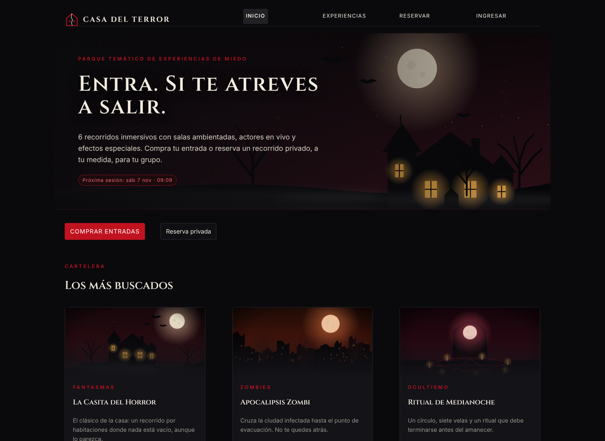
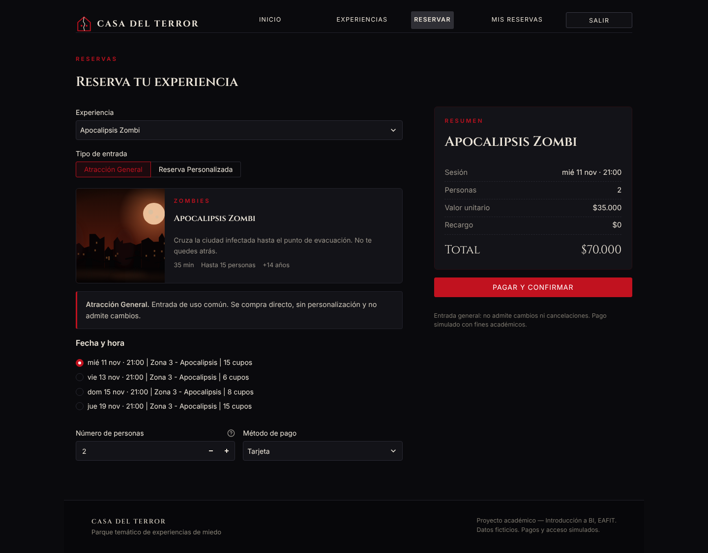
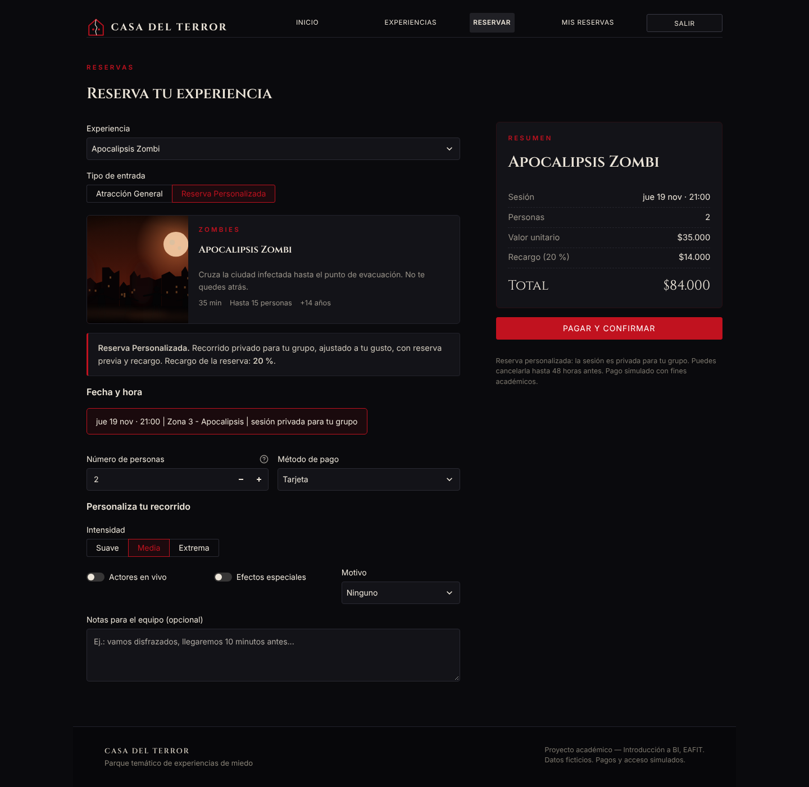
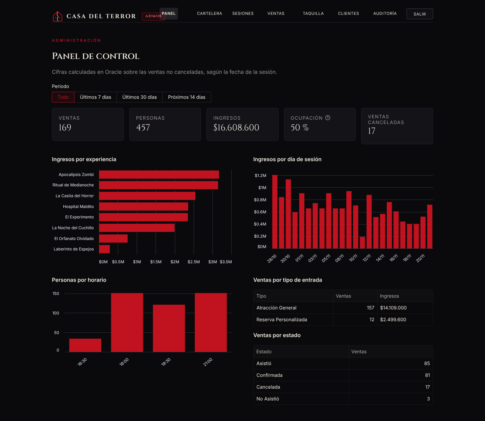
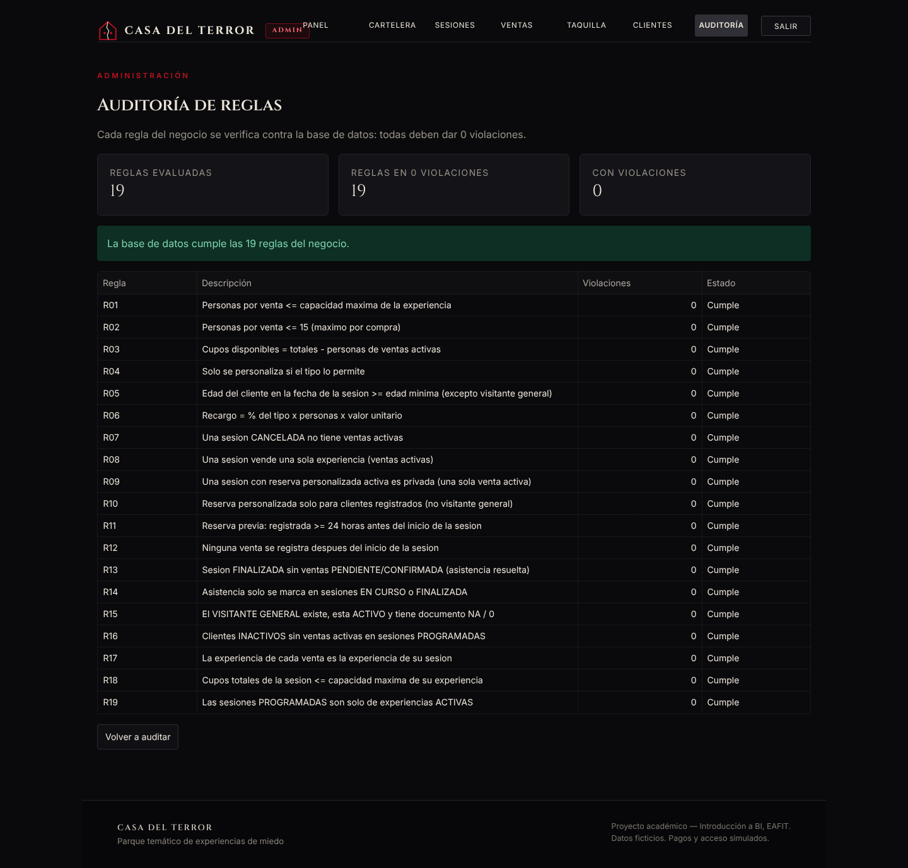
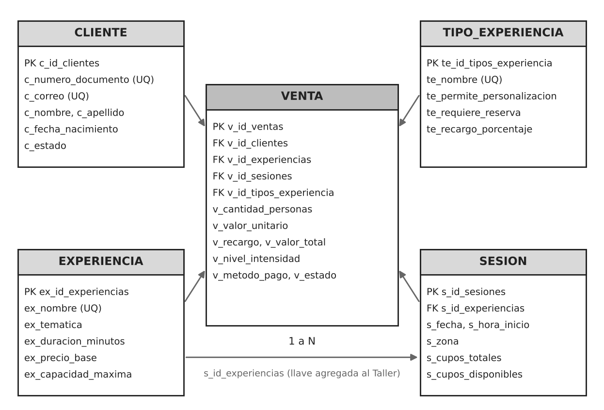

# Casa del Terror

Aplicación web de reservas para un parque ficticio de experiencias de miedo. Es el proyecto final del curso Introducción a BI (Universidad EAFIT): una base de datos Oracle con modelo en estrella y una interfaz hecha con Streamlit.



## Qué hace

El cliente explora la cartelera, compra entradas para las atracciones de uso común o reserva una experiencia privada con personalización (intensidad, actores en vivo, efectos especiales y motivo de celebración). Puede ver su historial y cancelar sus reservas personalizadas hasta 48 horas antes del inicio.

El administrador gestiona la cartelera y las sesiones, consulta las ventas y marca la asistencia, vende en taquilla, administra clientes y revisa un panel de indicadores. Una pantalla de auditoría ejecuta 19 consultas que verifican las reglas del negocio sobre los datos.

El ingreso y el pago son simulados. Todos los datos son ficticios.

## Tecnologías

- Python con Streamlit 1.67.0
- Oracle 21c XE (servicio `XEPDB1`) a través de `python-oracledb`
- pandas, Altair y segno (códigos QR)

## Estructura

```
.
├── App.py                       Aplicación completa, en un solo archivo
├── requirements.txt
├── .streamlit/
│   ├── config.toml              Tema y tipografías
│   └── secrets.toml.ejemplo     Plantilla de credenciales
├── static/                      Tipografías (Cinzel e Inter)
├── sql/                         Scripts 00 a 03 y documento de condiciones
├── tests/test_reglas.py         Pruebas automáticas
└── docs/                        Documentación completa e imágenes
```

## Requisitos

- Python 3
- Una base Oracle accesible (se probó con 21c XE en `localhost:1521/XEPDB1`)
- SQL Developer u otra herramienta para ejecutar los scripts

## Instalación

1. Crear las tablas y cargar los datos. Con la conexión al usuario del proyecto, ejecutar como script (F5 en SQL Developer), en este orden:

   - `sql/00_limpiar_casa_terror.sql` (opcional, borra las tablas del proyecto)
   - `sql/01_ddl_casa_terror.sql`
   - `sql/02_dml_casa_terror.sql`
   - `sql/03_auditoria_reglas.sql` (las 19 reglas deben mostrar 0 violaciones)

2. Instalar las dependencias, preferiblemente en un entorno virtual:

   ```
   pip install -r requirements.txt
   ```

3. Copiar `.streamlit/secrets.toml.ejemplo` como `.streamlit/secrets.toml` y completar los datos:

   ```toml
   [oracle]
   user = "USUARIO"
   password = "CLAVE"
   dsn = "localhost:1521/XEPDB1"

   [admin]
   password = "CLAVE_ADMIN"
   ```

   `secrets.toml` está en `.gitignore` y no debe subirse al repositorio. La clave de `[admin]` es la que se usa para entrar como administrador.

4. Ejecutar la aplicación desde la carpeta que contiene `App.py`:

   ```
   streamlit run App.py
   ```

   Se abre en http://localhost:8501. Para probar como cliente sirve cualquiera de los clientes de ejemplo; por ejemplo, documento `1000298538` y correo `juan.gomez@example.com`.

## Capturas









## Base de datos

El modelo tiene cinco tablas: `VENTA` como tabla de hechos y `CLIENTE`, `EXPERIENCIA`, `SESION` y `TIPO_EXPERIENCIA` como dimensiones. Cada fila de `VENTA` es una compra de entradas o una reserva para una sesión.



Se conservan las tablas y restricciones del Taller de diseño. El único cambio es la llave foránea `s_id_experiencias` en `SESION`, que indica qué experiencia se realiza en cada sesión.

## Reglas del negocio

Una parte la garantizan las restricciones de la base (dominios de los estados, llaves, valores únicos y que el total de la venta sea cantidad por valor unitario más recargo). El resto lo valida la aplicación y lo verifica la auditoría.

| Parámetro | Valor |
|---|---|
| Máximo de personas por compra | 15 |
| Anticipación mínima de una reserva personalizada | 24 horas |
| Cancelación por parte del cliente | Hasta 48 horas antes |
| Recargo de la reserva personalizada | 20 % |
| Inicio de una sesión por el administrador | Desde 60 minutos antes |

Los cupos se descuentan al crear la venta, con un `UPDATE` atómico y un bloqueo de la fila de la sesión, y se devuelven al cancelar. La lista completa de reglas (N01 a N17) y de auditorías (R01 a R19) está en la documentación.

## Pruebas

`tests/test_reglas.py` ejecuta 86 pruebas sobre las reglas del negocio, incluida una prueba de concurrencia sobre los últimos cupos de una sesión. Necesita las credenciales en variables de entorno:

```powershell
$env:ORACLE_USER="USUARIO"; $env:ORACLE_PASSWORD="CLAVE"; $env:ORACLE_DSN="localhost:1521/XEPDB1"
python tests\test_reglas.py
```

Las pruebas modifican datos. Después de ejecutarlas hay que volver a correr los scripts `00`, `01` y `02`.

## Limitaciones

- El ingreso (documento y correo) y el pago son simulados.
- La taquilla no valida la edad mínima; la verifica el personal en la puerta.
- Los tipos de entrada son de solo lectura en la aplicación.
- Al recargar la página, Streamlit reinicia la sesión del navegador y hay que volver a ingresar.

## Documentación

La descripción completa del diseño, las reglas, la aplicación y el manual de uso está en [`docs/Casa_del_Terror_Documentacion.docx`](docs/Casa_del_Terror_Documentacion.docx).

## Autor

Miguel Ángel Monroy Hurtado, Contaduría Pública, Universidad EAFIT.
